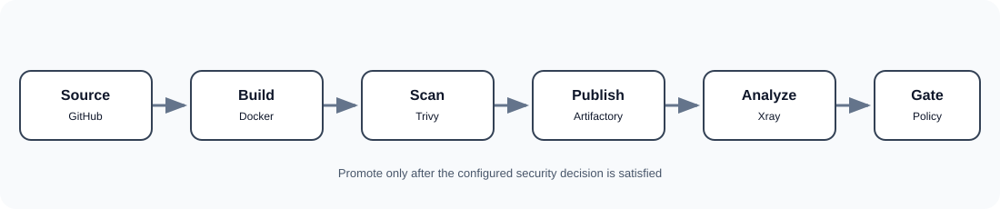

# JFrog DevSecOps: Secure Container Delivery



A hands-on, recruiter-ready project demonstrating a practical container security workflow using **Docker, Trivy, JFrog Artifactory, JFrog Xray, and Kubernetes admission controls**.

> **Project status:** The initial image `secure-api:v1` was built, scanned with Trivy, pushed to the JFrog Docker local repository `foma-docker-local`, indexed by Xray, and scanned. The Xray scan reported **78 vulnerability findings**: 17 High, 28 Medium, 33 Low, and 0 Critical in the captured scan. The image's Xray scan completed, and the UI showed 0 policy violations before a custom watch/policy was configured. See [evidence and findings](docs/04-xray-findings.md).

## What this project demonstrates

- Build a small Python API into a Docker image.
- Apply basic container hardening (non-root runtime user, minimal base image).
- Scan images locally with Trivy and interpret scanner output.
- Publish an image to JFrog Artifactory.
- Configure Xray indexing and inspect component vulnerabilities and SBOM data.
- Investigate a specific finding (CVE-2025-8869) rather than treating a scanner result as an automatic verdict.
- Define a security policy and attach it to a watch.
- Design a promotion gate before deployment.
- Document verification, limitations, and remediation evidence honestly.

## Architecture


The workflow separates artifact storage from security analysis and enforcement. Artifactory stores images; Xray analyzes indexed components. A policy defines acceptable risk conditions; a watch applies that policy to selected resources. A CI/CD integration or deployment admission control must enforce the result—creating a watch alone does not automatically block every push or deployment.

## Repository guide

| Path | Purpose |
|---|---|
| `app/` | Minimal Flask API |
| `Dockerfile` | Container build and hardening |
| `docs/` | Setup, architecture, labs, findings, policy/watch, screenshots |
| `security/` | Example policy and watch design |
| `k8s/` | Kubernetes deployment baseline |
| `.github/workflows/` | Example CI scan workflow |
| `scripts/` | Repeatable local build/scan helpers |

## Quick start

Requirements: Git, Docker Engine, Python (optional for local app execution), and Trivy.

```bash
git clone https://github.com/Fomainspi/jfrog.git
cd jfrog
docker build -t secure-api:v1 .
docker run --rm -d --name secure-api -p 5000:5000 secure-api:v1
curl http://localhost:5000/
curl http://localhost:5000/health
docker rm -f secure-api
trivy image --severity HIGH,CRITICAL secure-api:v1
```

Expected API response:

```json
{"application":"Secure API","version":"1.0","status":"running"}
```

## Learning path

1. [Environment preparation](docs/01-environment-setup.md)
2. [Build and scan the container](docs/02-build-and-trivy.md)
3. [Publish to Artifactory](docs/03-artifactory-publish.md)
4. [Xray indexing and findings](docs/04-xray-findings.md)
5. [Investigate CVE-2025-8869](docs/05-cve-investigation.md)
6. [Create an Xray policy and watch](docs/06-policy-and-watch.md)
7. [Kubernetes deployment baseline](docs/07-kubernetes-deployment.md)
8. [Evidence checklist and next steps](docs/08-evidence-and-next-steps.md)

## Security design decisions

- The sample app runs as an unprivileged user.
- Container tags are illustrative; production pipelines should also pin immutable digests.
- Do not commit JFrog access tokens, passwords, registry credentials, or kubeconfigs.
- Use GitHub Actions secrets or an approved secret manager for credentials.
- Trivy and Xray findings can differ because their databases, metadata, and analysis methods differ.
- A clean scan is time-bound; rescan when dependencies or vulnerability intelligence changes.
- Example thresholds in `security/` are lab recommendations, not universal compliance rules.

## Evidence and reproducibility

Screenshots captured during the hands-on session belong in `docs/evidence/`. Redact account emails, tokens, internal hostnames, and other identifying data before publishing. The recorded Xray numbers are point-in-time observations from the lab, not a promise that a future scan will return identical results.

## Author

**William Foma**  
DevOps / DevSecOps Engineer | Founder, FOMA — Foundation of Mastering Automation  
[Website](https://www.foma.life) · [GitHub](https://github.com/Fomainspi)

---

*Built as a practical learning project. Replace example hostnames, paths, and policies with values from your own JFrog instance.*
